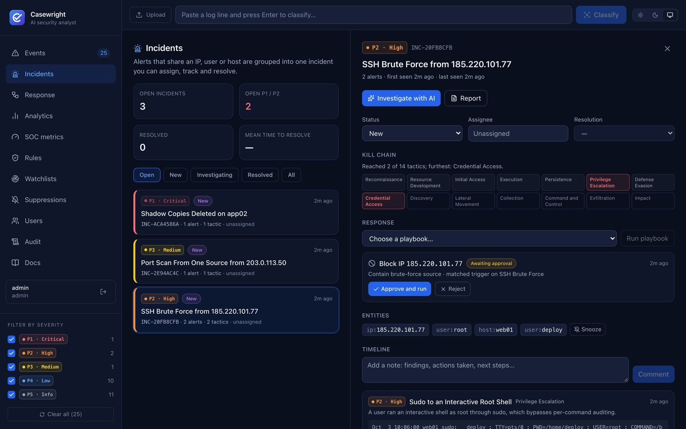
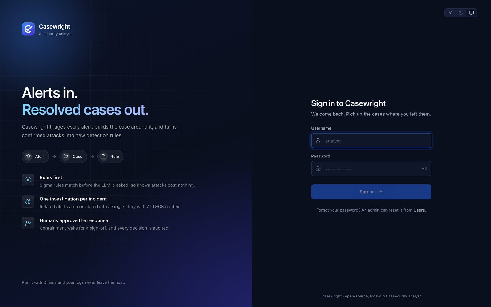
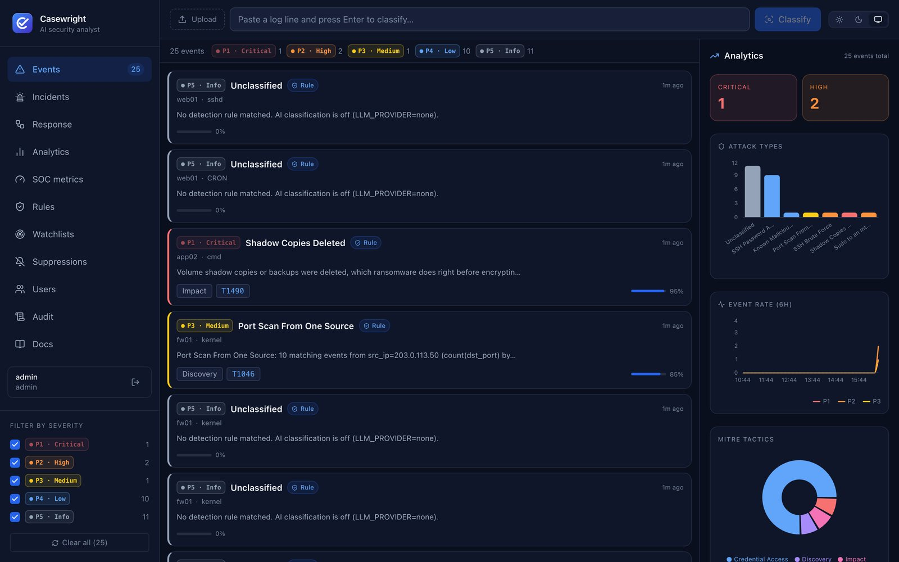
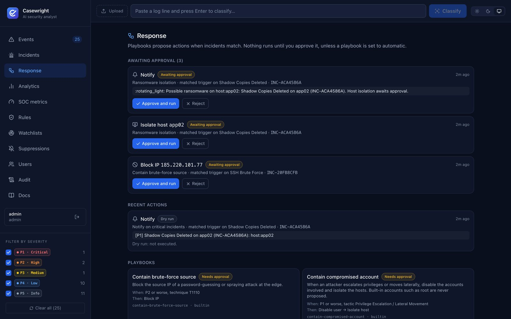
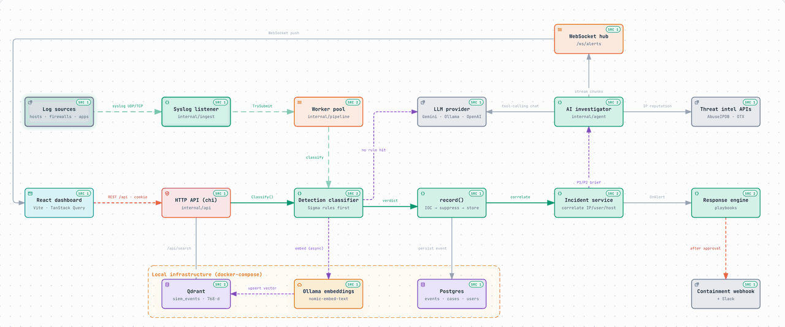

<div align="center">


# Casewright

**Open-source, local-first AI security analyst. Alerts in, resolved cases out.**

[](https://github.com/chanchalvdev/casewright/actions/workflows/ci.yml)
[](https://github.com/chanchalvdev/casewright/actions/workflows/security.yml)
[](https://github.com/chanchalvdev/casewright/releases)
[](LICENSE)


[Quick start](#quick-start) · [Architecture](#architecture) · [Features](#features) · [Docs](#documentation) · [Roadmap](ROADMAP.md)



</div>

## The problem

Security teams drown in alerts. A SIEM such as Wazuh or Elastic fires on every
failed login, port scan and suspicious process, and an analyst has to turn each
one into an answer by hand: is this real, is it part of something bigger, and
what do we do about it?

Putting an LLM on every alert does not fix this. It is slow and expensive at
log volume, it hallucinates on routine events, it sends sensitive logs to a
third party, and it should never get to block an IP or disable an account on
its own.

## What Casewright does

Casewright sits **after** your SIEM and does the analyst's first pass, with the
cheapest tool that can answer each step:

1. **Rules first.** A built-in Sigma engine matches known attacks
   in-process. A rule hit skips the LLM entirely, so routine alerts cost nothing.
2. **AI for the rest.** Anything no rule recognises is classified by an LLM
   (Gemini, OpenAI-compatible, or a fully local model through Ollama) with
   severity, MITRE ATT&CK mapping and IOCs.
3. **One case per attack.** Alerts that share an IP, user or host are correlated
   into a single incident with a kill chain, so a 500-line brute force is one
   case, not 500 tickets.
4. **One investigation per case.** When an incident becomes P1/P2, an AI agent
   investigates the whole story with threat-intel tools (AbuseIPDB, OTX, MITRE,
   similar past events) and writes a cited report.
5. **Humans approve the response.** Playbooks propose blocking an IP, disabling a
   user or isolating a host. Nothing runs until an analyst approves it, and
   every decision is audited.

Run it with Ollama and **no log ever leaves your machine**.

## Quick start

You need Docker. No API key, no configuration:

```bash
git clone https://github.com/chanchalvdev/casewright.git
cd casewright
make demo
```

Open **http://localhost:3000** and sign in as `admin` / `casewright-demo`.

A prepared attack is replayed on first start (SSH brute force → root shell, a
port scan, ransomware deleting shadow copies), so three incidents, a kill chain
and response actions awaiting approval are already there. Approve the IP block
and watch it reach the stand-in firewall:

```bash
docker compose -f casewright/demo/compose.yml logs -f webhook
```

The demo runs rules-only (`LLM_PROVIDER=none`). Add AI classification and
investigations with `LLM_PROVIDER=gemini GEMINI_API_KEY=... make demo`, and stop
everything with `make demo-down`. The demo uses a fixed password and no TLS, so
keep it local.

## Screenshots

| Sign in | Events |
|---|---|
|  |  |
| **Incident with kill chain** | **Response approvals** |
|  |  |

## Architecture



Every way in (syslog, HTTP API, CLI) goes through the same path:

| Step | What happens | Why it is built this way |
|---|---|---|
| **Ingest** | Syslog UDP/TCP lines go into a bounded worker pool. | When the pool is full, lines are dropped and counted. A slow LLM must never stall the senders. |
| **Detect** | Sigma and threshold rules run before anything else. | A rule hit skips the LLM. If the LLM is down, a matching rule still produces the alert. |
| **Classify** | Unmatched events go to an OpenAI-compatible LLM with structured JSON output. | One client works for Gemini, OpenAI and local Ollama. Prompts are versioned and scored by evals. |
| **Record** | IOC watchlist enrichment, suppressions, then storage in Postgres. | Suppressed events are stored but open nothing, so the record stays complete for hunting. |
| **Correlate** | Events sharing an IP, user or host within a window join one incident. | One story per attack, and one AI investigation per incident instead of one per alert. |
| **Investigate** | A tool-calling agent writes a cited report, streamed live over WebSocket. | Bounded concurrency: a busy agent skips and counts rather than queueing without limit. |
| **Respond** | Playbooks propose actions; approved actions go to one containment webhook or Slack. | Humans approve, and Casewright plugs into existing automation instead of shipping connectors. |
| **Search** | Events are embedded with `nomic-embed-text` and stored in Qdrant. | Analysts and the agent can recall similar past events by meaning, not keywords. |

A static, full-resolution version is in [`docs/assets/architecture.png`](docs/assets/architecture.png),
and the step-by-step write-up is in [docs/ARCHITECTURE.md](docs/ARCHITECTURE.md).

## Features

**Detect**
- Sigma detection engine (built in, no heavy dependency) with 16 built-in rules, plus any Sigma rules you add, such as SigmaHQ ([docs](docs/DETECTION.md))
- Threshold rules such as `count() by src_ip >= 10` for brute force, password spraying and scans
- Field normalisation (`source.ip`, `user.name`, `event.outcome`, …) so one rule works across log sources ([docs](docs/FIELDS.md))
- IOC watchlists from threat feeds, files or analysts, matched in constant time on every event ([docs](docs/WATCHLISTS.md))
- AI classification with severity P1–P5, MITRE ATT&CK tactic and technique, IOCs and remediation

**Investigate**
- Incidents with status, assignee, resolution, comments, kill chain and full timeline ([docs](docs/INCIDENTS.md))
- AI investigation of whole incidents with AbuseIPDB, OTX, MITRE and similar-event tools; analysts rate each report
- SOC metrics: MTTD, MTTA, MTTR (median, mean, p90), false-positive rate, backlog ageing, analyst workload
- Semantic search over past events (Ollama embeddings + Qdrant)
- Suppressions to snooze a noisy IP, user, host, rule or attack type; Markdown incident reports

**Respond**
- YAML playbooks propose block IP, disable user, isolate host, notify or webhook actions, with approval, dry-run and audit ([docs](docs/RESPONSE.md))

**Operate**
- Users with viewer, analyst and admin roles, bcrypt passwords, sessions, lockout and an audit log; API keys for machines ([docs](docs/USERS.md))
- PostgreSQL with versioned, checksummed migrations, plus an in-memory mode for quick local runs
- Prometheus metrics at `/metrics`, Swagger UI at `/docs`, health and readiness probes
- Responsive dashboard with light and dark themes that meet WCAG AA contrast

## Engineering highlights

- **Cost-aware AI.** Rules run first, and only events no rule explains reach the LLM. Every call saved is counted in a Prometheus metric.
- **Measured, not eyeballed.** Prompt changes are scored on a 128-case hand-labelled eval set that includes adversarial log lines. Pull requests that touch the classifier must pass an accuracy threshold in CI; promoting prompt v2 doubled accuracy on a local 3B model and cut invalid output from 42% to 7% ([results](casewright/evals/RESULTS.md)).
- **Back-pressure everywhere.** The syslog listener sheds load instead of blocking, investigations run in bounded slots, and threshold-rule state is capped so attacker-chosen keys cannot grow memory without bound.
- **Secure by default.** bcrypt passwords, hashed session tokens, `SameSite=Strict` cookies with a CSRF header, constant-time API-key comparison, per-IP rate limits, and no trust in a client-supplied `X-Forwarded-For`.
- **Tested.** 280 Go tests run with the race detector, Postgres and Qdrant integration tests run in CI, there are 25 Vitest suites and Playwright end-to-end tests, and the one-command demo is smoke-tested on every pull request.
- **Supply chain.** CodeQL, govulncheck, npm audit and secret scanning run on every PR. Releases ship binaries and GHCR images with provenance and an SBOM.

## Tech stack

| Layer | Technology |
|---|---|
| Backend | Go 1.26, chi, `log/slog`, worker-pool pipeline |
| AI | Gemini (default), Ollama (local) or any OpenAI-compatible API; tool-calling agent |
| Storage | PostgreSQL 16, Qdrant (vectors), Ollama `nomic-embed-text` (768-dim embeddings) |
| Frontend | React 19, TypeScript, Vite, TanStack Query, Tailwind CSS, Recharts |
| Observability | Prometheus, OpenTelemetry traces (Langfuse-compatible) |
| Delivery | Docker Compose, GitHub Actions, GHCR, Caddy on Oracle Cloud |

## Local development

Prerequisites: Go 1.26+, Node.js 22+, Docker. Optionally a [Gemini API key](https://aistudio.google.com/apikey); without one, use Ollama.

```bash
git clone https://github.com/chanchalvdev/casewright.git
cd casewright/casewright
cp .env.example .env      # set GEMINI_API_KEY, or LLM_PROVIDER=ollama for fully local
make setup                # Go modules + npm install
make docker-up            # Postgres, Qdrant, Ollama
make pull-models          # nomic-embed-text (+ llama3.2 for LLM_PROVIDER=ollama)
make serve                # API on http://localhost:8080
cd web && npm run dev     # dashboard on http://localhost:5173
```

From the repository root, `make quality-gate` runs exactly what CI runs:

```
Go:   gofmt → go vet → golangci-lint → go test -race → go build
Web:  tsc -b → oxlint → vitest run → vite build
```

To run the whole stack in containers, use `cd casewright && docker compose --profile app up -d --build`.
All settings are in [docs/CONFIGURATION.md](docs/CONFIGURATION.md).

## Releases and deployment

- **Releases** are cut from semver tags (`vX.Y.Z`) on `master`. Each release publishes Linux and macOS binaries plus the `ghcr.io/chanchalvdev/casewright-api` and `casewright-web` images, with provenance and an SBOM. See the [releases page](https://github.com/chanchalvdev/casewright/releases) and the [changelog](CHANGELOG.md).
- **Deployment:** [`casewright/deploy/oci/`](casewright/deploy/oci/README.md) runs the stack on one Oracle Cloud Always Free VM. Only Caddy (HTTPS) is public, classification uses a local model, and a release deploys after approval, rolling back if the health check fails.
- **Workflow:** trunk-based development with short-lived `<type>/<name>` branches, Conventional Commits and a protected `master` ([docs/BRANCHING.md](docs/BRANCHING.md)).

## Documentation

| Guide | What it covers |
|---|---|
| [Architecture](docs/ARCHITECTURE.md) | The flow from log line to resolved incident, component by component |
| [Configuration](docs/CONFIGURATION.md) | Environment variables, syslog ingestion, authentication |
| [API reference](docs/API.md) | Every HTTP and WebSocket endpoint, with examples |
| [Using Casewright](docs/USAGE.md) | Dashboard walkthrough and CLI mode |
| [Detection](docs/DETECTION.md) · [Fields](docs/FIELDS.md) · [Watchlists](docs/WATCHLISTS.md) | Sigma rules, field normalisation, IOC feeds |
| [Incidents](docs/INCIDENTS.md) · [Response](docs/RESPONSE.md) · [Users](docs/USERS.md) | Case management, playbooks, roles and audit |
| [Testing](docs/TESTING.md) · [Evals](casewright/evals/README.md) | Trying every feature, and scoring classifier changes |

## Project structure

```
casewright/
├── casewright/                 Go service and dashboard
│   ├── cmd/casewright/         entry point: HTTP server, CLI, migrations
│   ├── internal/
│   │   ├── api/                router, auth/CSRF/audit middleware, handlers, WebSocket hub
│   │   ├── detection/          Sigma + threshold engine, built-in rules
│   │   ├── classifier/         LLM classifier, versioned prompts
│   │   ├── incident/           correlation, case management, reports
│   │   ├── agent/              tool-calling investigation agent + tools
│   │   ├── response/           playbooks, approvals, webhook/Slack executor
│   │   ├── ingest/ · parser/   syslog listener, RFC 5424/3164/JSON parsing
│   │   ├── ioc/ · suppression/ watchlists and snoozes
│   │   ├── store/ · migrate/   Postgres stores and versioned migrations
│   │   └── auth/ · metrics/ …  users and sessions, Prometheus
│   ├── web/                    React dashboard (Vitest + Playwright)
│   ├── evals/                  labelled dataset and thresholds for the classifier
│   ├── demo/                   one-command demo with a scripted attack
│   └── deploy/oci/             single-VM production deployment
├── docs/                       guides, architecture diagram and screenshots
└── .github/workflows/          CI, security scans, evals, releases
```

## Roadmap

Detection, incidents, AI investigation, response and multi-user access are
working today. Next up: more enrichment tools, native connectors, UEBA, and
finally SSO and multi-tenancy. See [ROADMAP.md](ROADMAP.md).

## Contributing

Bug reports, detection rules, parsers and integrations are welcome. Read
[CONTRIBUTING.md](CONTRIBUTING.md) to get set up, and report vulnerabilities
privately as described in [SECURITY.md](SECURITY.md).

## Author

Built and maintained by **Chanchal** ([@chanchalvdev](https://github.com/chanchalvdev)).

## License

[MIT](LICENSE) © [chanchalvdev](https://github.com/chanchalvdev)
